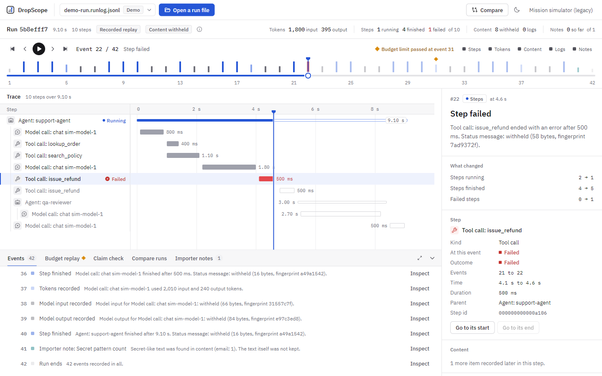
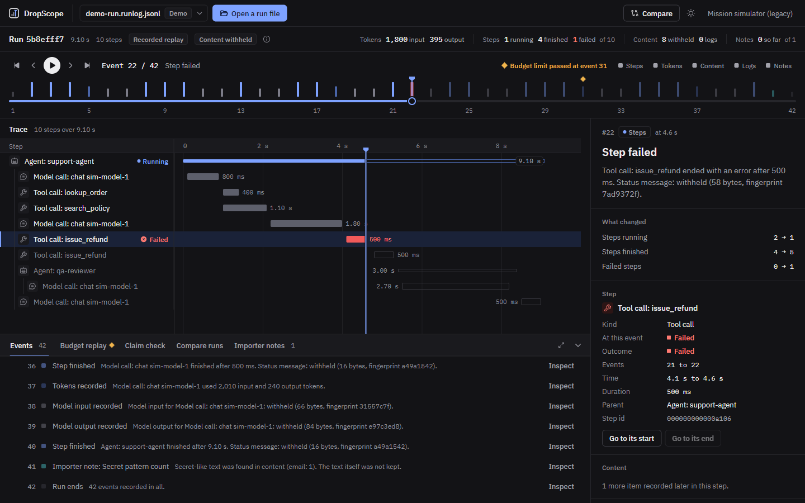

# DropScope

Replay a recorded AI agent run, offline. DropScope shows what the run had recorded at any step, whether a spending limit would have stopped it, whether a claim is backed by the recording, and where two runs first differ.

Replay checks make no model calls and send no data. Every answer is computed from a recorded run, the same way every time, so someone else can check it. It is not a tracing dashboard such as Langfuse or Arize Phoenix: it answers questions about a run that has already finished.

[Try it in your browser](https://alejandrorenalias.github.io/DropScope/).


<p>
  
  
</p>

> **Status.** The hosted demo comes with only built-in, invented demo runs and processes data entirely in your browser. There is no release or package yet.

## A small example

A support agent is asked to refund order 1042. It looks up the order, reads the refund policy, writes a draft, tries to issue the refund (the first attempt times out), tries again (it works), has a second agent review the draft, and writes the final answer. The run is saved as a trace.

With DropScope you can ask:

- **What did the run have recorded at step 24?** Two steps were still running, and one earlier step had failed.
- **Would a 4,000-token limit have stopped it?** Yes: a guard checking after each call would have fired at event 31, before the last model call.
- **Is "the refund was accepted" backed by the recording?** Yes: the text "accepted" appears in the recorded result of the second refund attempt.
- **Is "the order had been delivered" backed by the recording?** No: the recorded order result does not contain that text.
- **How does this run differ from a second run?** In the second run the refund fails both times, so the runs first differ at the second refund attempt.

## What it does

| Feature | The question it answers | Command line | On screen |
| --- | --- | --- | --- |
| **Import** | Turn an OpenTelemetry GenAI trace (OTLP/JSON) into a saved, validated run file. | `import` | (command only) |
| **State at a step** | What had the run recorded by step N? | `state --at N` | Scrub the timeline; the trace and the inspector follow |
| **Budget replay** | Where would a spending limit you choose have stopped this run? | `budget` | Budget replay tab |
| **Claim check** | Is each claim you wrote backed by what the run recorded? | `claims` | Claim check tab |
| **Run diff** | Where do two runs first differ? | `diff` | Compare runs tab |

The screens are on the **Run replay** page, which is the page the app opens on.

## Run it locally

DropScope runs on Windows, Linux and macOS (the Linux and macOS file checks are newer and less tested). You need Node.js 24 and npm.

```bash
npm install
npm run dev
```

Open the address Vite prints (normally `http://localhost:5173`), The **Run replay** page opens with a demo run already loaded. The [guided tour](docs/GUIDED_TOUR.md) walks through each screen with exact buttons and commands.

The same checks work from the command line on the demo files in the repository:

```bash
npm run forensics -- state src/frontend/assets/demo-run.runlog.jsonl --at 24
npm run forensics -- budget src/frontend/assets/demo-run.runlog.jsonl --max-total-tokens 4000
npm run forensics -- diff src/frontend/assets/demo-run-full.runlog.jsonl src/frontend/assets/demo-run-variant.runlog.jsonl
```

On Windows PowerShell, `npm.cmd` works in place of `npm` if script policies get in the way.

## Use your own trace

DropScope reads OTLP/JSON files that follow the OpenTelemetry GenAI conventions. Import one, then run any check on the saved run file:

```bash
npm run forensics -- import my-trace.json            # content is replaced by sizes and fingerprints
npm run forensics -- import my-trace.json --full     # keep content, needed for claim checks
```

The command prints where the run file was saved. See the [run event contract](docs/schemas/run-event-contract-v1.md) for what is kept and what is dropped. Read the note below on real traces first.

### Works with

DropScope reads the standard `gen_ai.*` attributes. Whether a stack works depends on the attribute names its instrumentation writes. DropScope also reads the names that OpenInference, OpenLLMetry and LangSmith use, and each step records which attribute it was read from. Each row was checked with a small synthetic trace written from the project's public documentation and source, not with a capture from a real installation, so a real stack can differ.

| Emitter | Status | What to expect |
| --- | --- | --- |
| OpenTelemetry instrumentation for the OpenAI Agents SDK | Tested | Agent, model-call and tool steps, with token totals. Handoff steps show as "Other". |
| Pydantic AI (Logfire or any OTel backend) | Tested | Agent, model-call and tool steps, with token totals. The Logfire attributes are ignored. |
| OpenLLMetry (Traceloop), current and older versions | Tested | Model-call and tool steps, with token totals. Workflow spans show as "Other". Older versions are read through `llm.request.type` and the prompt and completion token names. |
| LangChain and LangGraph, through the LangSmith OTel export | Tested | Model-call and tool steps, with token totals. The chain span shows as "Other". Read through `langsmith.span.kind`. |
| OpenInference (Arize Phoenix and Arize AX) | Tested | Agent, model-call and tool steps, with token totals. Read through `openinference.span.kind` and `llm.token_count.*`. |

In every row the default import keeps no prompt, answer or tool content. Details and the fixtures are in [Works with](docs/WORKS_WITH.md).

## Command line

The checks run as a `dropscope` command (Node.js 22.12 or newer). From a clone of this repository, run `npm install` once (it builds the command), then:

```bash
npx dropscope state src/frontend/assets/demo-run.runlog.jsonl --at 24
npx dropscope import my-trace.json
```

`npm link` makes `dropscope` available in any folder. The command is the same as `npm run forensics --`. It is not published to the npm registry yet.

## Where files go, and what runs on your computer

- Run files are saved outside the repository, in a folder only your account can use:

  | System | Default folder |
  | --- | --- |
  | Windows | `%LOCALAPPDATA%\DropScope\runs` |
  | macOS | `~/Library/Application Support/DropScope/runs` |
  | Linux | `$XDG_DATA_HOME/dropscope/runs`, or `~/.local/share/dropscope/runs` |

  The importer creates the folder with owner-only access (Windows: your account and SYSTEM; macOS and Linux: mode 0700, files 0600) and stops if it cannot check that. Permissions are set only when the folder is first created. It warns when the folder lies under a synced location such as OneDrive, Dropbox or iCloud.
- Input files must be plain local files: symbolic links are refused, and so are cloud placeholders (files that are not stored on this computer yet). Windows also refuses network paths.
- To check files on Windows, the commands call built-in Windows tools: PowerShell (to read file properties, once per file read) and `icacls` (to set folder permissions when `import` creates the folder). On macOS they call `stat` to read file flags. Nothing else is started and no command makes a network connection of its own.
- The browser screen reads a run file with a file picker, inside the browser. Nothing is uploaded.
- Please keep real agent traces out until the boundary in [ADR-028](docs/adr/ADR-028-real-trace-admission-needs-a-real-boundary.md) exists. A tool-level rule that blocks reads of the runs folder is only a precaution: it can be bypassed, so it cannot be a real boundary on its own.

## The original mission replay

Before it turned to agent run forensics, DropScope was a replayable research-workflow simulator. That part still works (the **Research Office**, **Tribunal Room**, **Review Office**, **Final Report** and **Mission Replay** screens), now behind the **Mission simulator (legacy)** link in the top bar. It uses fixed synthetic missions. Its normal flow starts no worker and makes no network request; two guarded pilots exist that act only when you ask them to (see the install guide). Its older guides are [Install and run](docs/INSTALLATION.md), [First mission replay](docs/FIRST_MISSION_REPLAY.md), [Architecture overview](docs/ARCHITECTURE_OVERVIEW.md) and [Synthetic fixtures](docs/SYNTHETIC_FIXTURES.md).

## Checking the project

```bash
npm run typecheck   # types
npm test            # unit tests
npm run build       # production build
npm run test:e2e    # browser tests (needs Chrome; the picture baselines are Windows only)
```

## Where to read more

- [Contributing](CONTRIBUTING.md): set up, tests, formatting and pull requests.
- [Guided tour](docs/GUIDED_TOUR.md): ten minutes with the demos.
- [Architecture](docs/ARCHITECTURE.md): the path from a trace file to a saved run, the checks and the screens, with one diagram.
- [Run event contract](docs/schemas/run-event-contract-v1.md) and [ADR-027](docs/adr/ADR-027-run-event-contract-and-trace-import-boundary.md): how a run file is built and checked.
- [Works with](docs/WORKS_WITH.md): which trace emitters import, and what is missing for the others.
- [Limitations and responsible use](docs/LIMITATIONS_AND_RESPONSIBLE_USE.md).

## License

MIT. See [LICENSE](LICENSE).
