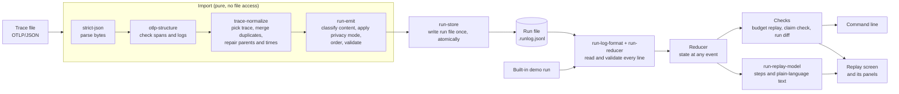

# Architecture: the run forensics path

This page covers one path: how a trace file becomes a saved run, and how the checks and screens read it. It does not cover the legacy mission simulator (see [ARCHITECTURE_OVERVIEW.md](ARCHITECTURE_OVERVIEW.md) for that).

## The stages

**Import.** `importTraceBytes` in `src/run-import.ts` turns bytes into a list of run events. It reads no file and writes none. A strict JSON parser rejects anything ambiguous (duplicate keys, trailing bytes, limits exceeded) before values are built. Then the structure check turns the JSON into typed spans and log records. Normalizing selects one trace, merges duplicate spans, repairs missing parents and times, and sorts by content so the order of the input cannot change the result. The emitter classifies every value as structure or content, applies the privacy mode, orders the events and validates them against the event schemas.

**Privacy mode.** The default mode keeps no content. Prompts, answers and tool input and output are replaced by their size and a short fingerprint. `--full` keeps them, which claim checks need. The rules live in `src/run-privacy.ts`, and the reducer applies the same rules again when it reads a file.

**Run file.** One event per line, in canonical JSON, with LF line ends. `run-store` writes it to a temporary name, validates it from disk, then publishes it under its final name without overwriting anything. The name is the trace id plus part of the artifact id. The event types are `RunStarted`, `StepStarted`, `StepEnded`, `UsageRecorded`, `ContentRecorded`, `LogRecorded`, `ImportNote` and `RunEnded`. The [run event contract](schemas/run-event-contract-v1.md) is the full specification.

**Reading.** The browser and the command line use the same reader, `parseRunLog`. It checks every line (strict syntax, canonical form, schema) and then the whole history. The reducer (`validateRunHistory`) checks the order of events and, for runs without content, the privacy rules. A file that was edited by hand fails here and is refused.

**Reducer.** `createReplay` in `src/run-reducer.ts` returns the recorded state at any event: open and closed steps, token totals, content counts, failed steps, notes. It shows only what the recording says, and makes no claim about what the model knew.

**Checks.** Each check reads a validated history and nothing else. All run offline.

| Check | File | Question |
| --- | --- | --- |
| Budget replay | `src/budget-replay.ts` | Where would a guard with these limits have stopped this run? |
| Claim check | `src/claim-check.ts` | Does the recorded content support each claim? (needs `--full`) |
| Run diff | `src/run-diff.ts` | Where do two runs first differ? |

**Screens.** `src/frontend/run-replay-model.ts` has no React and no Node modules. It turns a history into steps, a step tree and plain-language text. `run-replay.tsx` draws that model as one workspace: the timeline (`run-timeline.tsx`), the trace waterfall (`run-waterfall.tsx`), the inspector (`run-inspector.tsx`) and the tabs (`run-dock.tsx`) that hold the event list, the importer notes and the panels (budget, claims, diff). Its tokens and styles are in `run-replay.css`. The screen opens the built-in demo run, or a run file chosen by the user and read inside the browser. The command line (`src/run-cli.ts`) calls the same importer, reader and checks.

## Rules that hold across the path

- The importer and the reader are pure. Only `run-files.ts` and `run-store.ts` touch the file system, and only the command line calls them.
- A file is never trusted because DropScope wrote it. Every read validates again.
- Output never repeats input text. It shows fixed words, counts, ids and escaped paths.
- Nothing in this path makes a network call.
